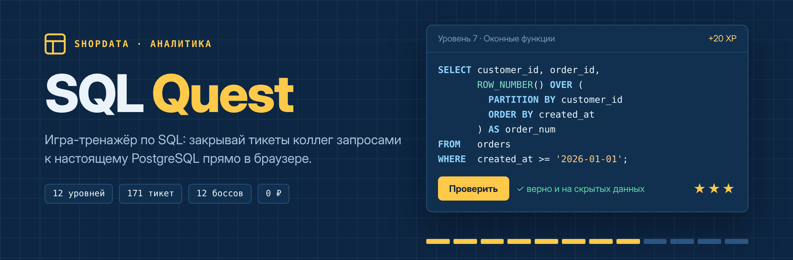
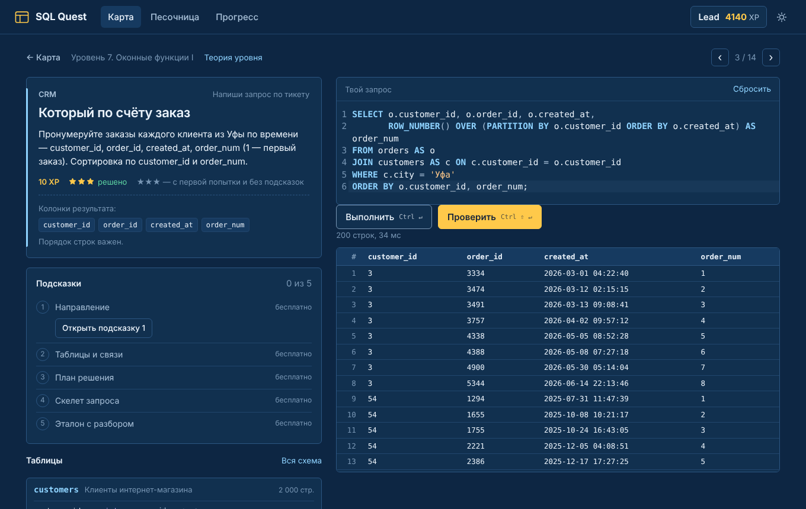
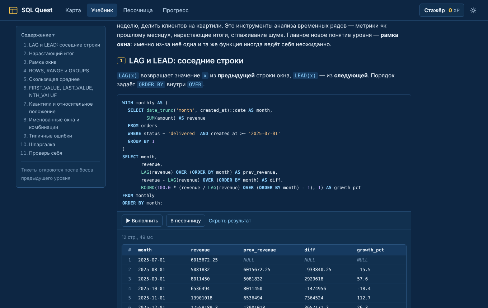
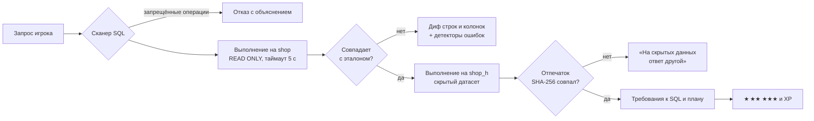
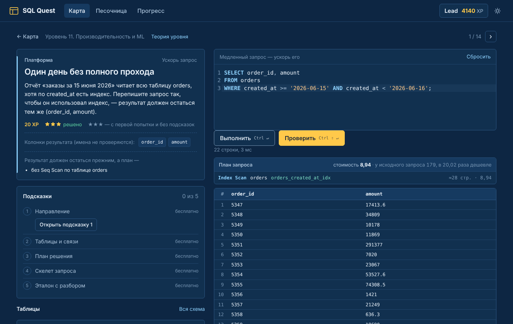
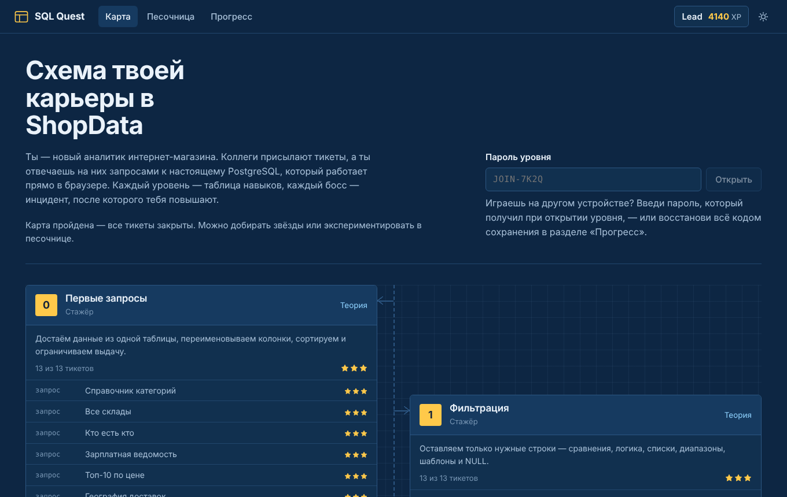
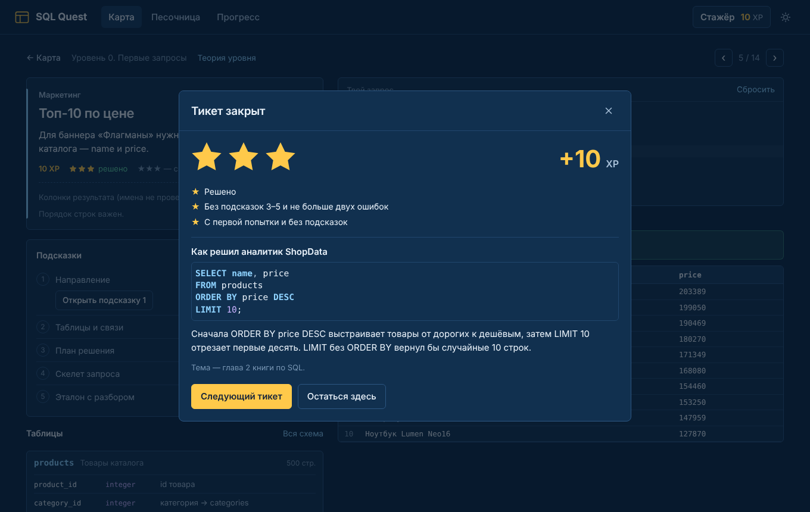
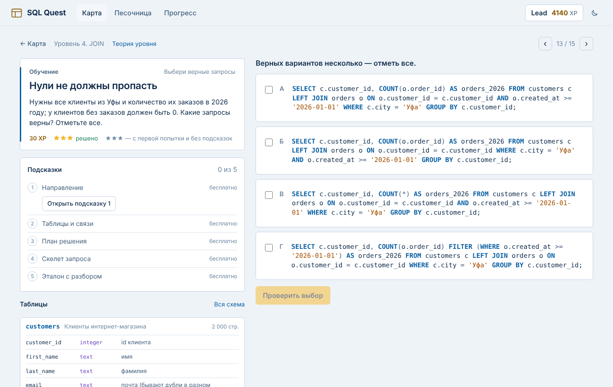
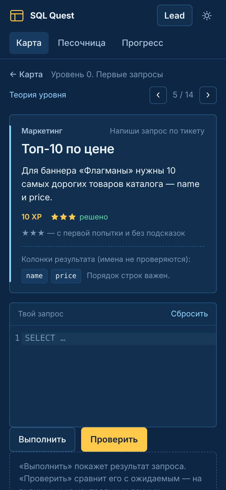
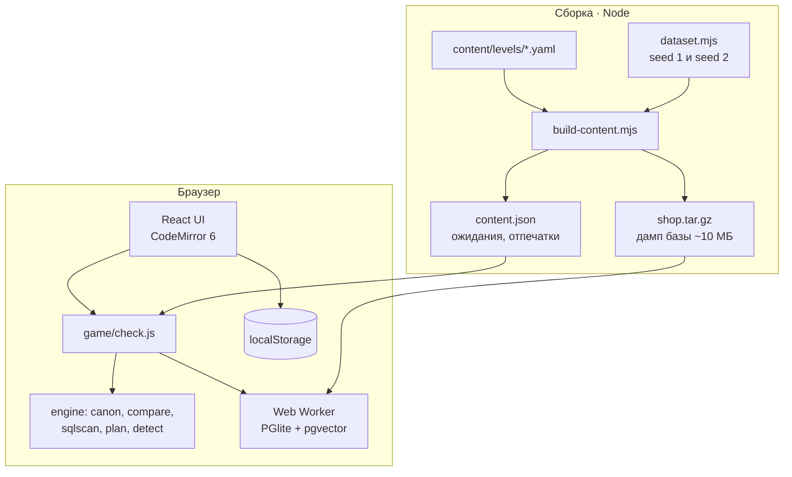

<p align="center">
  <a href="https://hpainh.github.io/sql-quest/"></a>
</p>

<p align="center">
  <a href="https://hpainh.github.io/sql-quest/"></a>
</p>

<p align="center">
  
  
  
  
  
</p>

<p align="center">
  <b>Ты — новый аналитик интернет-магазина ShopData.</b><br>
  Коллеги присылают тикеты, ты отвечаешь запросами к настоящему PostgreSQL, который работает прямо во вкладке браузера.<br>
  12 уровней, 171 тикет, 12 боссов — от первого <code>SELECT</code> до <code>EXPLAIN</code>, когорт и pgvector.<br>
  Встроенный учебник: 12 глав, около 20 000 слов теории и 200+ примеров, которые запускаются прямо на странице.
</p>

<p align="center">
  <a href="#-уровни">Уровни</a> ·
  <a href="#-учебник">Учебник</a> ·
  <a href="#-как-устроена-проверка">Проверка</a> ·
  <a href="#-прогресс-без-сервера">Прогресс</a> ·
  <a href="#-скриншоты">Скриншоты</a> ·
  <a href="#-запуск-и-публикация">Запуск</a> ·
  <a href="#-как-добавить-задачу-или-теорию">Свои задачи</a>
</p>

<br>

<p align="center">
  
</p>

## ✦ Что отличает игру

| Возможность | Как работает |
| --- | --- |
| 🐘 **Настоящий PostgreSQL** | Не эмулятор и не SQLite: PGlite запускает PostgreSQL 18 в WebAssembly. Работают `FILTER`, `DISTINCT ON`, `LATERAL`, рекурсивные CTE, `jsonb`, `generate_series`, оконные рамки, `EXPLAIN` и pgvector. |
| 🎯 **Проверка по результату** | Подходит любой верный запрос, а не один «правильный» текст. Ответ сверяется на видимых данных и на скрытом наборе, поэтому захардкоженные значения не проходят. |
| 📖 **Учебник внутри игры** | К каждому уровню — глава теории: объяснение с нуля, примеры на данных ShopData с кнопкой «Выполнить», ловушки, вопросы с собеседований, шпаргалка и самопроверка. Читать можно любую главу, даже если её тикеты ещё закрыты. |
| 🧭 **Подсказки, которые учат** | 5 ступеней на каждый тикет: направление → таблицы → план → скелет → эталон с разбором. Каждая открытая подсказка уменьшает награду. |
| 🔎 **Разбор ошибок** | 29 детекторов типовых ошибок (`= NULL`, `COUNT(*)` после `LEFT JOIN`, размножение строк, целочисленное деление, `UPDATE` без `WHERE`, рамка `LAST_VALUE`…) и 32 кода ошибок PostgreSQL с объяснением по-русски. |
| 🏢 **Живой датасет** | 16 таблиц e-commerce: клиенты, заказы, платежи, доставки, склады, промокоды, события сайта, A/B-тесты, эмбеддинги. В данных есть грязь, как в реальной работе: дубли email, NULL, двойные платежи. |
| 🔒 **Без сервера и регистрации** | Статический сайт на GitHub Pages. Прогресс хранится в браузере и переносится паролем уровня или кодом из 17 символов. Работает офлайн. |

## ◆ Уровни

Уровень открывается, когда закрыт босс предыдущего и решено не меньше 70% его тикетов.

| № | Уровень | Грейд | Тикетов | Босс |
| :-: | --- | --- | :-: | --- |
| 0 | Первые запросы | Стажёр | 14 | Инцидент: вторая десятка |
| 1 | Фильтрация | Стажёр | 14 | Инцидент: подозрительные заказы |
| 2 | Функции и выражения | Стажёр | 14 | Инцидент: письмо старожилам |
| 3 | Агрегация | Junior | 15 | Инцидент: квартальный отчёт |
| 4 | JOIN | Junior | 15 | Инцидент: что мы продаём |
| 5 | Подзапросы и множества | Junior | 15 | Инцидент: сверка оплат |
| 6 | CTE и рекурсия | Middle | 14 | Инцидент: выручка поддеревьев |
| 7 | Оконные функции I | Middle | 14 | Инцидент: витрина хитов |
| 8 | Оконные функции II | Middle | 13 | Инцидент: дневная динамика |
| 9 | Аналитические паттерны: когорты, воронки, retention, A/B | Senior | 15 | Инцидент: матрица удержания |
| 10 | Данные и транзакции: DML, UPSERT, ограничения | Senior | 14 | Инцидент: дубли клиентов |
| 11 | Производительность и ML: EXPLAIN, индексы, признаки, pgvector | Lead | 14 | Инцидент: витрина признаков |

Каждый уровень опирается на главы [книги по SQL](#-связь-с-книгой): после решения игра показывает эталон, разбор и номер главы.

### Типы задач

| Тип | Что делает игрок | Как проверяется |
| --- | --- | --- |
| **Напиши запрос** | Решает тикет с нуля | Результат совпадает с эталонным на обоих датасетах |
| **Таблица по образцу** | Видит готовую таблицу и восстанавливает запрос | То же, без текстового описания задачи |
| **Найди баг** | Чинит запрос коллеги, который выдаёт неверный результат | Исправленный запрос даёт верный результат |
| **Предскажи результат** | Выбирает, что вернёт запрос, не запуская его | Варианты вычислены на реальной базе при сборке |
| **Заполни пропуск** | Дописывает недостающую часть запроса | Как «Напиши запрос» |
| **Выбери верные** | Отмечает все корректные запросы из нескольких | Корректность каждого варианта проверена при сборке |
| **Ускорь запрос** | Переписывает медленный запрос | Тот же результат + требования к плану `EXPLAIN` (нет `Seq Scan`, стоимость ниже в N раз) |
| **Измени данные** | Пишет `INSERT` / `UPDATE` / `DELETE` / `UPSERT` / DDL | Скрипт выполняется в транзакции, состояние проверяется запросом, затем всё откатывается |

## 📖 Учебник

Раздел «Учебник» в верхнем меню — 12 глав, по одной на уровень. Главу можно открыть и прямо из тикета кнопкой «Теория уровня»: она откроется поверх задачи, и черновик запроса не потеряется.

| Что есть в каждой главе | Зачем |
| --- | --- |
| Объяснение темы с нуля, по шагам | понять, а не запомнить синтаксис |
| Примеры на данных ShopData | у каждого кнопки «Выполнить» и «В песочницу»; запросы на изменение данных выполняются в транзакции и откатываются, у запросов из главы про производительность можно посмотреть план |
| Ловушки, советы, вопросы с собеседований | выделены цветом прямо в тексте |
| Запросы с ошибками | помечены красным, по кнопке видно, что ответит PostgreSQL |
| «Типичные ошибки», «Шпаргалка», «Проверь себя» | повторить главное перед тикетами; ответы на вопросы раскрываются по клику |

Все 200+ примеров проверяются при сборке: `npm run content` выполняет каждый на настоящей базе и падает, если пример сломался или запрос «с ошибкой» вдруг выполнился без ошибки.

<p align="center">
  
</p>

## ✓ Как устроена проверка



- **Сравнение как мультимножества:** порядок строк важен только там, где его требует тикет, и тогда ничьи по ключу сортировки допускаются. Числа приводятся к 6 знакам, поэтому `100.0` и `100` равны.
- **Скрытый датасет** сгенерирован с другим seed и содержит то, чего нет в видимом: лишний город, домен почты, категорию и склад. Решение вида `VALUES (...)` или `WHERE id IN (...)` на нём не проходит.
- **Эталоны не лежат в открытом виде:** клиент получает ожидаемые строки и отпечаток результата на скрытых данных, а текст эталона обфусцирован до момента решения.
- **CI проверяет контент:** `npm run content` выполняет все 171 эталон на обоих датасетах. Сборка падает, если результат пустой, колонки не совпадают, на границе `LIMIT` есть ничья или «запрос с багом» случайно выдаёт верный ответ.

<p align="center">
  
</p>

## ★ Прогресс без сервера

| Механика | Правило |
| --- | --- |
| **XP** | 10 / 20 / 30 по сложности, босс — 100. Подсказки 1–5 оставляют 90 / 80 / 65 / 50 / 0% награды |
| **★** | Тикет решён |
| **★★** | Не больше 2 подсказок и не больше 2 ошибок |
| **★★★** | Бонус задачи; по умолчанию — с первой попытки и без подсказок |
| **Грейд** | Стажёр → Junior → Middle → Senior → Lead, растёт с уровнями |
| **Автосохранение** | `localStorage` браузера |
| **Пароль уровня** | Вида `JOIN-7K2Q`, открывает уровень на любом устройстве |
| **Код сохранения** | Весь прогресс в 17 символах с контрольной суммой, плюс экспорт и импорт `.json` |

## ▣ Скриншоты

<table>
  <tr>
    <td width="50%"><br><sub><b>Карта</b> — уровни как таблицы ER-схемы, внутри тикеты со звёздами</sub></td>
    <td width="50%"><br><sub><b>Тикет закрыт</b> — звёзды, XP, эталон с разбором и глава книги</sub></td>
  </tr>
  <tr>
    <td width="50%"><br><sub><b>Светлая тема</b> — задача «выбери все верные запросы»</sub></td>
    <td width="50%" align="center"><br><sub><b>Телефон</b> — тикет, редактор и результат в одну колонку</sub></td>
  </tr>
</table>

Ещё в игре есть **песочница** со всей схемой из 16 таблиц и просмотром плана любого запроса.

## ▶ Запуск и публикация

Нужен Node.js 22+.

```bash
npm install
npm run content   # генерирует датасеты, проверяет все задачи, собирает базу
npm run dev       # http://localhost:5173
npm test          # тесты движка
npm run build     # продакшен-сборка в dist/
```

**Публикация на GitHub Pages одной командой** (Windows, нужны Git, Node.js и GitHub CLI):

```powershell
powershell -ExecutionPolicy Bypass -File .\scripts\publish.ps1
```

Скрипт проверит окружение, соберёт и протестирует проект, создаст публичный репозиторий, включит Pages, запушит код, дождётся деплоя и откроет сайт. Параметры: `-Repo имя`, `-SkipChecks`, `-DryRun`.

<details>
<summary>Вручную</summary>

1. Создай репозиторий `sql-quest` и запушь проект в ветку `main`.
2. Settings → Pages → Build and deployment → Source: **GitHub Actions**.
3. Workflow `.github/workflows/deploy.yml` соберёт контент, прогонит тесты и опубликует сайт на `https://<логин>.github.io/sql-quest/`.

</details>

## ✎ Как добавить задачу или теорию

Задачи лежат в `content/levels/LNN.yaml`. Минимальный пример:

```yaml
- id: L01-15
  type: write_query
  difficulty: 2
  customer: Маркетинг
  title: Название тикета
  ticket: Текст тикета для игрока.
  tables: [orders]
  expected_columns: [order_id, amount]
  ordered: true
  order_keys: [amount]
  reference: |
    SELECT order_id, amount FROM orders ORDER BY amount DESC LIMIT 5;
  hints:
    - Направление
    - Таблицы и связи
    - План решения
    - Скелет запроса
    - Разбор эталона
```

`npm run content` выполнит эталон на обоих датасетах и остановит сборку, если с задачей что-то не так.

**Теория** уровня лежит в `content/theory/LNN.md` — обычный Markdown, где `## Заголовок` начинает раздел главы. Дополнительные блоки:

| Разметка | Что получится |
| --- | --- |
| `` ```sql `` | пример с кнопкой «Выполнить»; запросы на изменение данных выполняются и откатываются |
| `` ```sql-error `` | пример с ошибкой; сборка проверяет, что он действительно падает |
| `` ```sql-plan `` | кнопка «Показать план» |
| `` ```sql-static `` | фрагмент без запуска |
| `> **Ловушка.** …`, `> **Совет.** …`, `> **На собеседовании.** …` | цветные врезки |
| `?? Вопрос` и строки `:: ответ` | вопрос для самопроверки с раскрывающимся ответом |

<details>
<summary>Поля для остальных типов</summary>

| Тип | Поля |
| --- | --- |
| `fix_bug` | `broken_query` — запрос с ошибкой; сборка проверяет, что он действительно даёт неверный результат |
| `fill_blank` | `template` с пропуском `___` |
| `predict` | `query`, `ask`, `distractor_*` — правильный вариант вычисляется на базе |
| `choose` | `options` и `expect_correct` — фиксирует ожидаемые верные варианты |
| `write_dml` | Скрипт-эталон и `verify` — запрос после скрипта; либо `check: returning`, либо `plan` с запросом-пробой |
| `optimize` | `start_sql` — медленный запрос; `plan.forbid` / `plan.require` — узлы плана по таблицам; `max_cost_ratio` — во сколько раз должна упасть стоимость |
| любой | `required` / `forbidden` — обязательные и запрещённые конструкции SQL, `bonus` — условие третьей звезды, `common_mistakes` — свои детекторы |

</details>

## ⚙ Архитектура



```
content/          задачи по уровням, главы учебника (theory/) и описание схемы
scripts/          генератор датасета, сборщик контента, publish.ps1
src/engine/       сравнение результатов, сканер SQL, анализ плана, детекторы, ошибки PostgreSQL
src/game/         проверка попытки, XP, звёзды, коды сохранения, пароли
src/db/           PGlite в Web Worker с таймаутом 5 секунд
src/ui/           экраны игры
tests/            тесты движка
docs/             баннер и скриншоты для README
```

**Стек:** React 19, Vite, CodeMirror 6, PGlite 0.5 (PostgreSQL 18 в WebAssembly), pgvector, Vitest, GitHub Actions + Pages.

## ❖ Связь с книгой

Игра построена на методичке по SQL для ML-специалистов: 29 глав на PostgreSQL 17 с тем же датасетом интернет-магазина. PostgreSQL 18 в браузере — надмножество 17-й версии, поэтому все примеры из книги работают в песочнице без изменений.

## Лицензия

[MIT](LICENSE) © German Gadzhimagomedov
